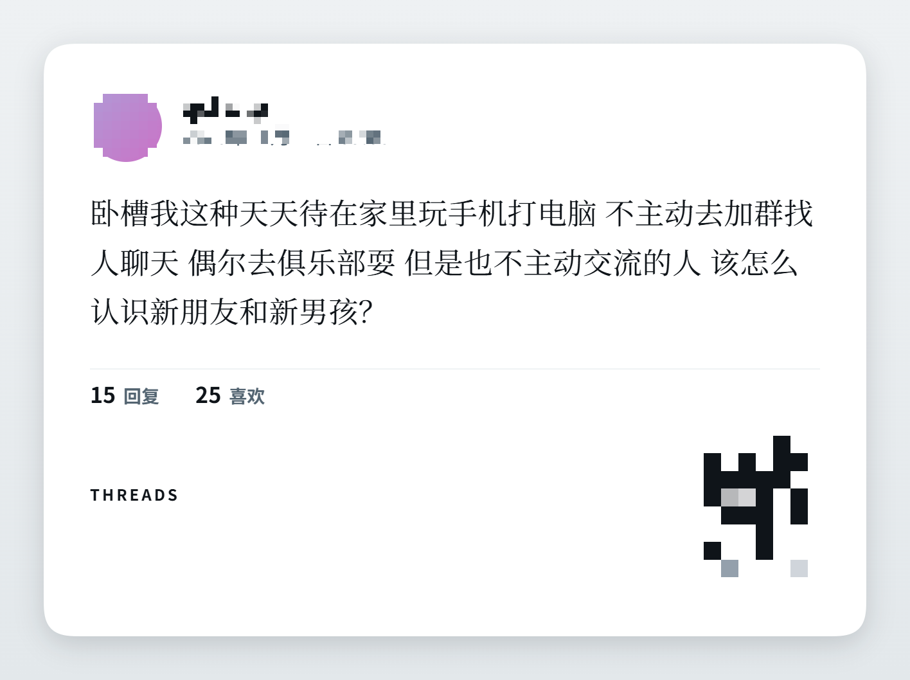

# Threshare

把 [Threads](https://www.threads.com/) 帖子重绘成 **X 风格分享卡片**，外加一个 420×900 的手机版刷帖小窗。

> **非官方工具**，与 Meta / Threads 无关联。仅供个人使用，详见[免责声明](#免责声明)。


<p align="center">
  <sub>四图帖效果：G2 圆角 · 衬线正文 · 黑体加粗作者名 · 二维码带 Threads 标记</sub>
</p>

---

## 功能

### 1. 分享卡片

每条帖子操作栏尾部多一个按钮，点一下把帖子重绘成图片：

- **G2 连续圆角**（superellipse，不是普通圆弧）
- **衬线体正文** + **黑体加粗作者名**，贴近 X 的排版
- 多图自动排布（最多 4 格，超出叠 `+N`）
- 串文（1/2、2/2）合并成一张卡，续帖用浅底块区分
- 二维码代替链接（文字链接在转发的图里点不了）
- 可复制到剪贴板 / 导出 PNG

| 单图 | 详情页 |
| --- | --- |
|  |  |

### 2. 手机版小窗

点扩展图标弹出 420×900 竖窗，Threads 在这个宽度下自动切成手机版布局
（单列、顶栏、轮播、底栏导航），适合放在屏幕角落边刷边干活。


---

## 安装

1. Chrome 打开 `chrome://extensions/`
2. 右上角开启「开发者模式」
3. 点「加载已解压的扩展程序」，选择本目录（含 `manifest.json` 的那层）
4. 点工具栏的 Threshare 图标 → 弹出手机版小窗
5. 打开任意 Threads 帖子页，操作栏尾部即出现分享按钮

无需构建步骤。改了源码后在扩展页点一下刷新即可生效。

---

## 实现要点

这里记录几个**踩过的坑**，都是实测确认的，不是推测。

### 为什么是小窗而不是侧边栏

原本想做 `chrome.sidePanel` + iframe 把 Threads 塞进侧边栏。实测**不可行**：

- `threads.com` 返回 `X-Frame-Options: DENY`
- 用 `declarativeNetRequest` 去掉该头后，iframe 确实能加载（子 frame URL 正常、DOM 200KB+）
- 但页面变成「链接失效」——Threads 在子 frame 里**拒绝建立会话**（cookie 为空）。
  先用顶层页预热拿到 cookie 再开 iframe，仍然失效。
  宽度、UA、referrer、sandbox 逐项试过，全部无效

结论：拒绝不只在响应头，还在会话层。改用独立 `type: "popup"` 窗口。
**本项目没有使用任何手段绕过 Threads 的技术保护**，`manifest.json` 里没有
`declarativeNetRequest` 权限。

### 选择器策略

Threads 的 class 名是构建期混淆的哈希（`x1a6qonq` 这类），随构建变动，**不能**作为选择器。
所以只依赖两类稳定锚点：

- 结构标记：`data-pressable-container`、`data-pagelet`
- 无障碍语义：`<time datetime>`、`<a href="/@user/post/...">`、`svg <title>`

### emoji 与配图必须分开

Threads 的 emoji / 贴纸是 `<span>` 里的 ``（src 指向 giphy），和正文同一个 `span[dir=auto]`。
如果用「span 里含 img 就不是正文」过滤，**正文会整段消失，卡片只剩计数数字**。

判据按可靠性排序：

| 判据 | 说明 |
| --- | --- |
| 结构签名（最可靠） | emoji/贴纸在行内 `<span>`；配图在 `<div>` / `<picture>` 媒体容器 |
| 渲染尺寸 | 真实页面上 emoji 只渲染 20-40px，配图上百 px |
| 自然尺寸（兜底） | giphy 贴纸 `naturalWidth` 可达 200px+，不能作主判据 |

### 不能见 `<a>` 就当装饰

单图帖会把配图包进 `a[href="/@user/post/xxx/media"]`（点图看原图），多图则是 `img → div → div`。

所以必须**只排除指向作者主页的链接**（`^/@[^/]+/?$`），不能写成
`closest('a[href^="/@"]')` —— 那会把单图帖唯一的一张配图删掉，
表现正是「单图不显示、多图正常」。

### 详情页的 UI 污染

帖子详情页的主容器 `[data-pressable-container]` **同时装着**帖子和页面级控件：
「排序 热门 更多」「查看动态」「回复输入框」「回复列表」。

靠「从段落锚点向上扩到祖先」取正文，会把整块页面 UI 吃进卡片。修法：

1. 只取锚点自己的文本，不取祖先的 `textContent`
2. 用操作栏位置做归属分界：正文在操作栏之上，之下都是回复区

### 二维码（微信式，中心留空）

自己实现（`src/qrcode.js`，零依赖 —— MV3 不允许远程加载脚本，引库又要走打包）。
设计成微信那种：**中心留空**放图标，Threads 标记另外放在**卡片右上角**。

| 项 | 值 | 依据 |
| --- | --- | --- |
| 纠错等级 | **H（30%）** | 留空靠纠错补回；M 级留空 30% 就全崩 |
| 中心留空 | **26%** | H 级实测 40% 仍可解码，取 26% 留足余量 |
| 静区 | 2 模块 | 扫码器需要四周留白 |

实现时刻意踩过并修掉的三个 bug（都写进了代码注释）：

1. **v≥7 缺版本信息** → 整码报废。18 位 BCH 必须画在左下与右上
2. **格式信息按 LSB 写** → 应 MSB-first
3. **版本信息位置写成行列对调** → `row=floor(i/3), col=i%3+size-11`

验证方式不是只看矩阵函数，而是**从真实渲染的卡片 PNG 里抠出二维码再解码**。

### 图片加载顺序：网络优先，元素兜底

CDN 地址带时效签名（`oe=...`），页面放久了重新请求会 403。
理论上复用页面上已解码的 `` 最快，**但会污染 canvas**：
页面里的 img 多数没带 CORS，直接 `drawImage` 会让 `toDataURL` 抛
`Tainted canvases may not be exported`，导出彻底失效。

所以顺序是：先走网络拿 CORS 副本 → 失败才复用页面元素。

---

## 测试

```bash
npm i                                   # 装 devDependencies
node dev-server.js 8788                 # 起本地服务

node tests/verify-manifest.js           # 版本号 + 图标在真实扩展环境生效
node tests/verify-qr.js                 # 二维码矩阵能被 jsQR 解码（多版本）
node tests/verify-qr-hole.js            # 中心留空的安全上限
node tests/verify-thread-media.js       # 跨段媒体合并 + 4 格 +N + 圆点策略
node tests/e2e-extension.js             # 真实扩展加载 + 点击 + 导出
node tests/e2e-media.js                 # 8 图网格 + 串文合并
node tests/e2e-popup.js                 # 小窗方案 + 分享链路
```

浏览器打开这几个页面看渲染结果：

| 页面 | 验什么 |
| --- | --- |
| `/tests/harness.html` | 基础渲染 |
| `/tests/harness-page.html` | 按 manifest 顺序注入脚本，验挂载 + 弹层 + 导出 |
| `/tests/harness-media.html` | 多图网格、`+N` 角标、串文合并 |
| `/tests/harness-emoji.html` | emoji 不混入媒体 + 正文不丢 |
| `/tests/harness-detail.html` | 详情页 UI 不污染正文 |
| `/tests/harness-single.html` | 单图能提取（配图包在 `/media` 链接里） |

测试夹具（`tests/dumps/`）是**匿名化过的**结构快照：真实账号已替换为
`demo_alpha` 这类占位名，图片 URL 指向 `placehold.example`，DOM 结构保持原样。

### 环境限制（实测确认，不是代码 bug）

- Chrome 154 起 `--load-extension` 命令行开关被移除，扩展测试需用 Playwright 自带的 Chromium
  （脚本会自动探测本机 `%LOCALAPPDATA%\ms-playwright`）
- headless 下 `chrome.windows.create` 的 `width/height` 不生效，视口一律 1280×720；
  真实有头模式生效。所以 `e2e-popup.js` 用 `setViewportSize(420x900)` 复现小窗宽度
- Playwright 启动的 Chromium 访问 threads.com 会被判定为自动化并返回 **403**。
  夹具测试不受影响；要测真实页面需手动装扩展

---

## 结构

```
manifest.json                 MV3 清单（版本号唯一事实来源）
icons/                        扩展图标 16/32/48/128
src/background.js             点图标开小窗、记住窗口
src/util.js                   版本号读取、文本折行、G2 圆角路径、并发图片加载
src/extract.js                从 Threads DOM 提取帖子（作者/正文/媒体/计数/串文）
src/qrcode.js                 二维码生成（H 级纠错 + 中心留空）
src/render.js                 X 风格卡片布局与 canvas 绘制
src/content.js                分享按钮挂载、预览弹层、复制与导出
tools/make-icons-browser.js   重新生成图标
tools/make-readme-shots.js    生成 README 截图（含马赛克）
tests/                        本地 harness 与真实扩展 e2e
```

---

## 免责声明

- 本项目是**非官方工具**，与 Meta Platforms, Inc. 及 Threads 无任何关联，未获其认可或授权。
- 本项目**不收集、不上传**任何数据。所有处理都在你本地浏览器里完成（可审代码验证：
  没有 `fetch` / `XMLHttpRequest` / 上报逻辑）。
- 本项目**不绕过** Threads 的任何技术保护措施。
- 分享出去的内容来自 Threads 上的其他创作者。**转载他人内容前，请自行确认是否符合
  当地法律与原作者意愿**。工具只是帮你把内容排版成图片，不改变内容本身的著作权归属。
- 使用本工具可能触及平台服务条款的解释空间。**风险由使用者自行承担**，
  包括但不限于账号受限。作者不对任何后果负责。
- 请遵守你所处地区的法律法规。

---

## License

[MIT](LICENSE)
