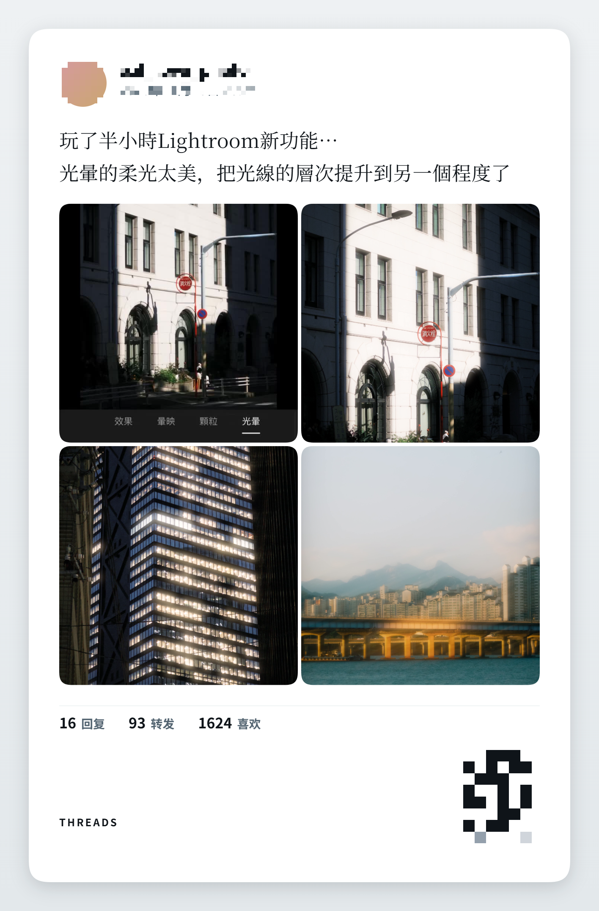
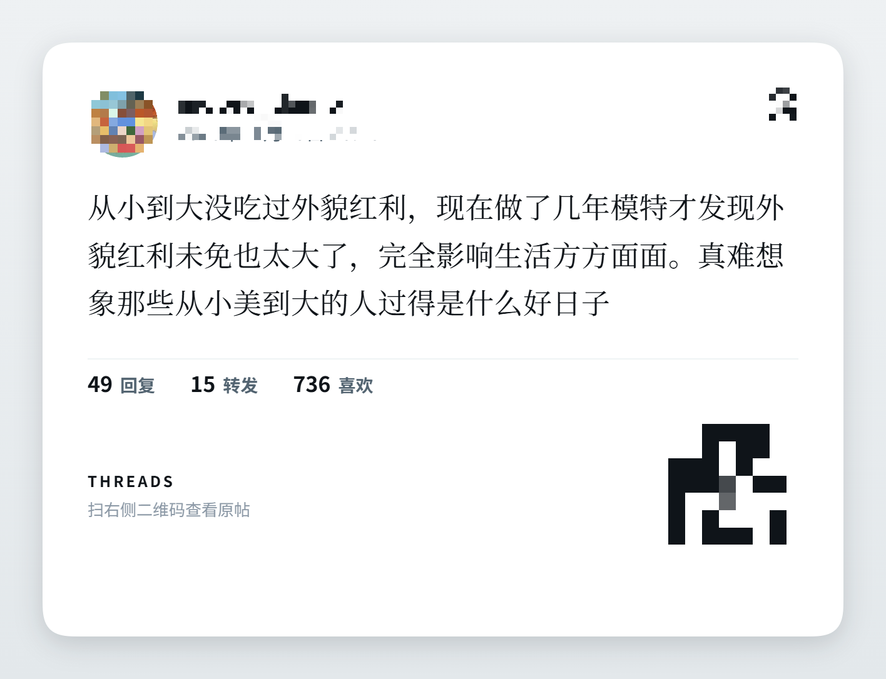
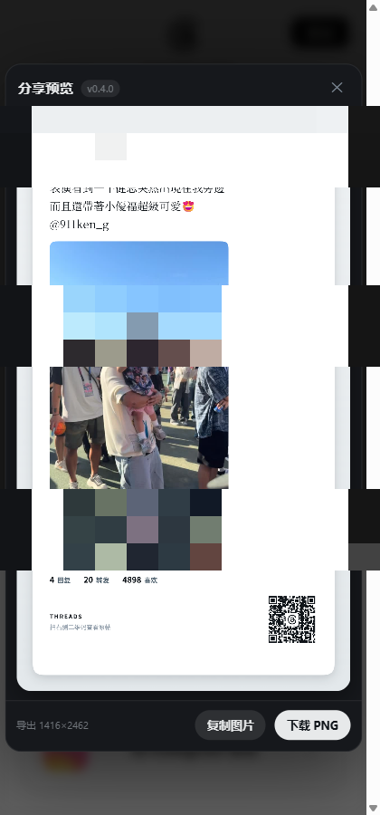

# Threshare

<p align="center">
  <b>把 Threads 帖子变成漂亮的分享卡片</b><br>
  <sub>G2 圆角 · 衬线正文 · 二维码 · 手机版小窗</sub>
</p>

<p align="center">
  <a href="LICENSE"></a>
  
  
  
  <a href="https://github.com/iv3rins/threads-kits/stargazers"></a>
</p>

<p align="center">
  
</p>

---

## ✨ 功能

| | |
|---|---|
| 🖼 **分享卡片** | 一键把帖子重绘成图片，G2 连续圆角 + 衬线正文 + 黑体加粗作者名 |
| 🖼 **多图排布** | 自动排版，最多 4 格，超出叠 `+N` |
| 🧵 **串文合并** | 1/2、2/2 合成一张卡，续帖用浅底块区分 |
| 📱 **手机版小窗** | 420×900 竖窗，Threads 自动切手机布局 |
| 🔗 **二维码** | 微信式中心留空，H 级纠错，扫得出 |

<p align="center">
  
  
</p>

---

## 🚀 安装

```text
1. 打开 chrome://extensions/
2. 开启右上角「开发者模式」
3. 点「加载已解压的扩展程序」，选择本项目目录
4. 完成 —— 帖子操作栏会出现分享按钮
```

无需构建，改完源码在扩展页刷新即可。

---

## 🧠 踩过的坑

这些都是实测确认的，不是推测。想看细节的点开。

<details>
<summary><b>为什么是小窗而不是侧边栏</b></summary>

想做 `chrome.sidePanel` + iframe 把 Threads 塞进侧边栏。实测**不可行**：

- `threads.com` 返回 `X-Frame-Options: DENY`
- 用 DNR 去掉该头后，iframe 能加载，但页面变成「链接失效」
- 原因是 Threads 在子 frame 里**拒绝建立会话**（cookie 为空）
- 宽度、UA、referrer、sandbox 逐项试过，全部无效

所以改用独立 popup 窗口。**本项目没有绕过任何技术保护**。
</details>

<details>
<summary><b>不能见 <code>&lt;a&gt;</code> 就当装饰（单图不显示的根因）</b></summary>

单图帖会把配图包进 `a[href="/@user/post/xxx/media"]`（点图看原图），多图则是 `img → div → div`。

所以必须**只排除指向作者主页的链接**（`^/@[^/]+/?$`），不能写成
`closest('a[href^="/@"]')` —— 那会把单图帖唯一的一张配图删掉。
</details>

<details>
<summary><b>emoji 与配图必须分开</b></summary>

emoji / 贴纸是 `<span>` 里的 ``（src 指向 giphy），和正文同一个 `span[dir=auto]`。
如果用「span 里含 img 就不是正文」过滤，**正文会整段消失**。

判据优先级：结构签名（span vs div/picture）> 渲染尺寸 > 自然尺寸。
</details>

<details>
<summary><b>主页上不能把独立帖当串文</b></summary>

个人主页整页都是同一个作者，只看「同作者 + 紧随其后」会把 4 条互不相干的帖子合并。

真串文是作者连续写完的：实测两段相差 **3 分 37 秒**，而主页独立帖相差数小时到数天。
所以加 30 分钟时间窗口判据。
</details>

<details>
<summary><b>详情页的 UI 污染</b></summary>

帖子详情页的主容器同时装着帖子和页面级控件（排序栏、查看动态、回复框）。

修法：① 只取段落锚点自己的文本 ② 用操作栏位置做归属分界。
</details>

<details>
<summary><b>二维码 v7+ 会整码报废</b></summary>

自己实现二维码时踩了三个坑：

1. v≥7 缺**版本信息**（18 位 BCH）→ 整码报废
2. 格式信息按 LSB 写 → 应 MSB-first
3. 版本信息位置写成行列对调

验证方式：从真实渲染的卡片 PNG 里抠出二维码，用 jsQR 独立解码。
</details>

---

## 🧪 测试

```bash
npm i                     # 装 devDependencies
npm test                  # 单元测试
npm run test:e2e          # 真实扩展 e2e
npm run serve             # 起本地服务看 harness
```

| 测试 | 覆盖 |
|---|---|
| `verify-manifest.js` | 版本号 + 图标在真实扩展环境生效 |
| `verify-qr.js` | 二维码矩阵能被 jsQR 解码 |
| `verify-qr-hole.js` | 中心留空的安全上限（H 级 40%） |
| `verify-thread-detect.js` | **主页不误合并串文** + 真串文能识别 |
| `verify-thread-media.js` | 跨段媒体合并 + 4 格 `+N` |
| `e2e-*.js` | 真实 Chromium 加载扩展跑完整链路 |

测试夹具已**匿名化**：真实账号替换为 `demo_*`，图片指向 `placehold.example`，DOM 结构保持原样。

---

## 📁 结构

```text
manifest.json        MV3 清单
icons/               扩展图标
src/
  background.js      点图标开小窗
  util.js            折行、圆角路径、并发图片加载
  extract.js         DOM 提取（作者/正文/媒体/计数/串文）
  qrcode.js          二维码生成（H 级 + 中心留空）
  render.js          卡片布局与 canvas 绘制
  content.js         按钮挂载、预览弹层、导出
tools/               图标与截图生成
tests/               harness 与 e2e
```

---

## ⚠️ 免责声明

- **非官方工具**，与 Meta / Threads 无关联，未获授权
- **不收集、不上传**任何数据，全部在本地浏览器完成
- **不绕过** Threads 的任何技术保护措施
- 分享内容来自其他创作者，**转载前请自行确认授权**
- 使用可能触及平台条款的解释空间，**风险自负**

---

## 📄 License

[MIT](LICENSE)
